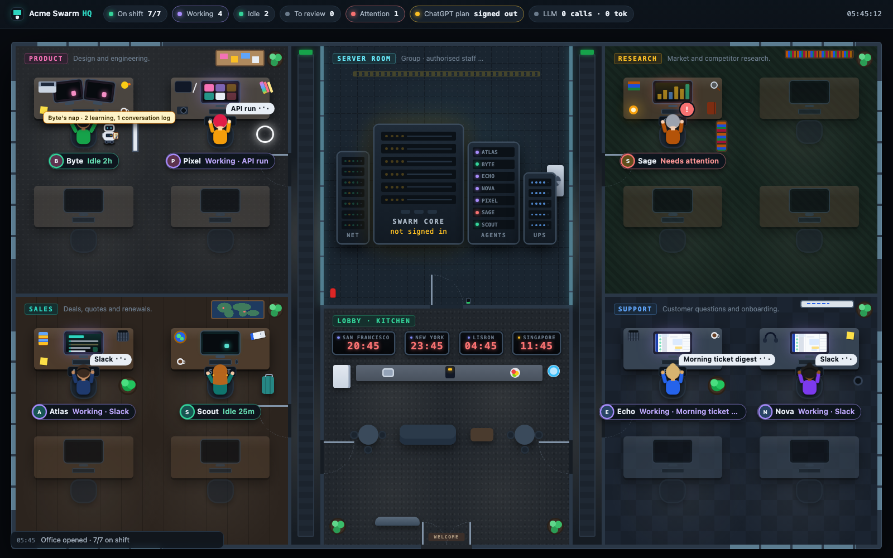
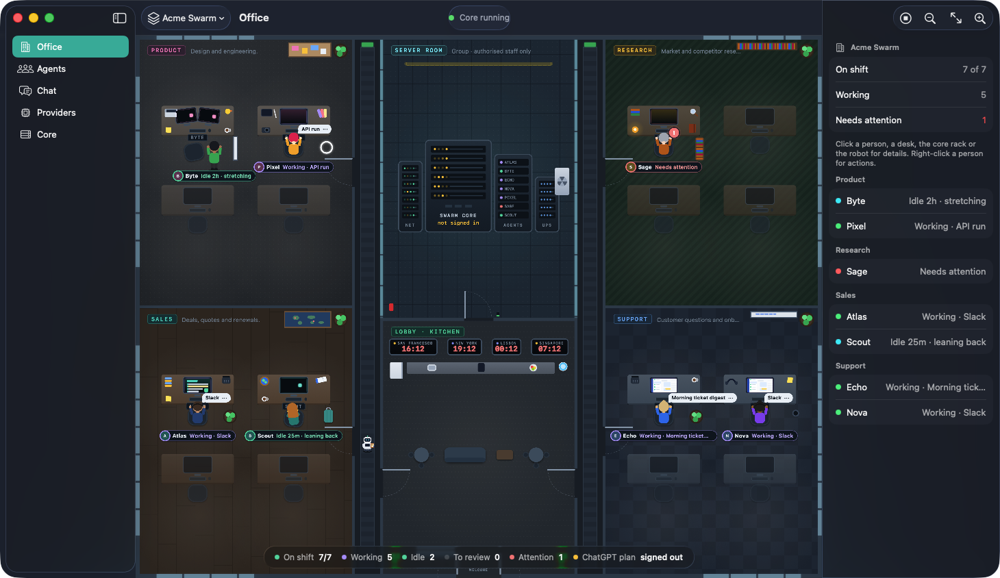
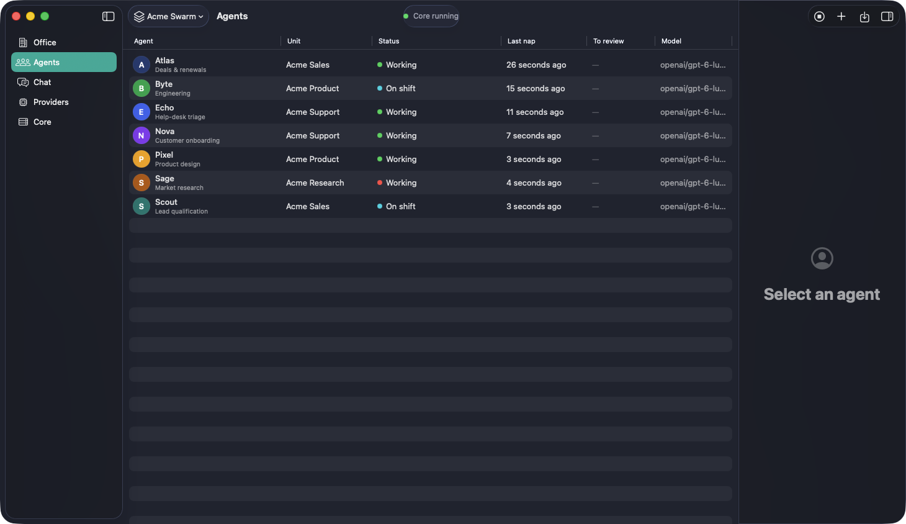
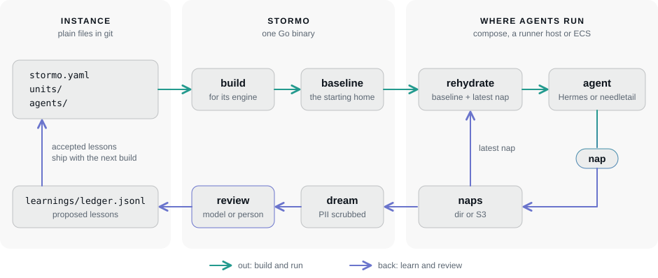

<p align="center">
  <picture>
    <source media="(prefers-color-scheme: dark)" srcset="docs/brand/logo-dark.svg">
    
  </picture>
</p>

**Run a team of AI agents like a small company.** Stormo takes your organisation's agents, defined
as plain files in git, runs them on your laptop, a host of yours or AWS, watches them work, and
turns what they learn on the job into reviewed changes to those files.



*The office, served by `stormo core` (its browser pages are opt-in, `core.web_ui: true`): each unit
is a room, each agent sits at a desk dressed for its role, and the name tags say what it is doing
right now (a Slack turn, a scheduled job, idle). The little robot carries each agent's latest
snapshot back to the server room and notes what changed. This one is the bundled demo
(`go run ./examples/office-demo`), a made-up company with simulated activity.*

## What it does

- **Agents as files.** An *instance* is one organisation's directory: `stormo.yaml`, units, agents
  (manifest, personality, skills, schedules), personas and bridge actions. It versions, reviews and
  moves like any other repo ([docs/instances.md](docs/instances.md)). An agent is one folder in an
  engine-neutral format; `stormo export` packs it into a zip and `stormo import` brings it into
  another instance.
- **One place at a time, anywhere.** The same agent runs in a local Docker Compose project, on a
  host of yours through `stormo runner`, or as an ECS task. `stormo handoff` moves it between local
  and ECS with its memory, skills and history (never its credentials).
- **Learning you can review.** Sidecars snapshot what each agent learns ("naps"). A dream folds
  the naps into proposed lessons and skill, schedule and setting changes, scrubbed of personal
  data. `stormo learn` runs that for a person to review. The core's learning cycle (daily with
  `core.learning.at`, or now with `stormo core learn`) by default has a model approve the obvious
  ones and pass the rest to a person; it never rejects, and rules in code keep for a person what a
  model must not decide (personal data, scripts, wider permissions, every promotion to a unit or
  the group). Accepted changes ship with the next build; until a reviewer decides, the skills and
  scripts an agent wrote carry over its restarts through its naps.
- **Isolation by design.** Agents see only their unit's lessons, documents and bridge actions, plus
  what is shared group-wide. Secrets are names in git; their values live in the instance's local
  secrets files (shared, and one per agent) or in AWS Secrets Manager.
- **A control plane with a face.** `stormo core` tracks the fleet, runs learning cycles,
  carries messages between agents and owns their shared documents. Models come through named
  connections: a ChatGPT plan, which the core signs in to and serves to its agents, or an API
  (OpenRouter, OpenAI, Anthropic, any compatible endpoint). The core can run on another machine,
  reached by URL and token ([docs/core.md](docs/core.md)).
- **Channels and voice.** Agents work in Slack, Telegram and WhatsApp
  ([docs/whatsapp.md](docs/whatsapp.md)) and answer over their own chat API. With a voice
  connection (ElevenLabs), needletail agents hear voice notes and answer with them, in a voice
  they can pick themselves for review.
- **Capabilities.** Heavy or shared work (a browser, transcription, image generation, video
  renders) runs in workers the core wakes on demand, granted per agent
  ([docs/capabilities.md](docs/capabilities.md)).
- **Linked devices.** A watch or a phone signs in once and reaches the fleet through a small device
  gateway, while the core stays on loopback ([docs/devices.md](docs/devices.md)). `apps/wearos` is
  a Wear OS app for it.
- **Pluggable engine.** Each agent runs on [Hermes](https://hermes-agent.nousresearch.com/docs/) or
  on needletail, Stormo's own Go runtime whose agents write sandboxed Luau tools
  ([docs/needletail.md](docs/needletail.md)), behind one interface. The example instance runs
  needletail.

The `stormo` binary is the CLI you run, the core service, and the sidecar inside every agent's
task. Needletail is a second Go binary, shipped as its own image.

## Quick start

Download the archive for your platform from [Releases](https://github.com/camfinc/stormo/releases)
(Linux and macOS, amd64 and arm64), check it against `SHA256SUMS`, and put `stormo` on your PATH.
A released binary pulls its matching sidecar image, `ghcr.io/camfinc/stormo-sidecar:<version>`, the
first time it starts an agent, and a needletail agent pinned to a release pulls
`ghcr.io/camfinc/needletail:<version>`. Or build from source:

```sh
git clone https://github.com/camfinc/stormo.git && cd stormo
go build -o bin/stormo ./cmd/stormo          # Go 1.26
ln -s "$PWD/bin/stormo" ~/.local/bin/stormo  # anywhere on your PATH

go run ./examples/office-demo                # the office above, at http://127.0.0.1:18700/
```

A source build makes its own sidecar image from `docker/sidecar.Dockerfile` when it first needs one.

Then make it yours. Start from the example instance, describe your organisation and its first
agent, and start it:

```sh
stormo new instance ~/acme --name "Acme Swarm" --template example   # without --template: an empty one
cd ~/acme && $EDITOR stormo.yaml units/ agents/
stormo check                # validate and compile every agent
stormo secrets init         # secrets.local.yaml (gitignored, 0600): fill in the values
stormo core up              # the core and its model gateway; prints its address (http://127.0.0.1:18600/ or the next free port)
stormo core login           # sign in with ChatGPT: the example's agents take their model from the core
stormo start                # build, then run every agent locally (Docker compose v2: OrbStack, Docker Desktop, Linux)
```

Without the sign-in, the example's agents fall back to their cloud model on OpenRouter, whose key is
optional in the example: set it with `stormo secrets set shared OPENROUTER_API_KEY` (the value on
stdin). The office page needs `core.web_ui: true`.

The example's agents pin a needletail build that was never published. Before `stormo start`, set
each agent's `engine.version` to a release (for example `0.6.0`) and remove its `image_tag`, or
build that image from a checkout of the engine ([docs/instances.md](docs/instances.md), "Engines").

Stormo finds the instance from the current directory (or `--instance <dir>`, or
`STORMO_INSTANCE`). Vendoring the engine inside the instance as a git submodule keeps both in step
([docs/instances.md](docs/instances.md)).

## The Mac app

On macOS 26 or later, Stormo also comes as an app: download `Stormo-<version>.dmg` from
[Releases](https://github.com/camfinc/stormo/releases), open it and drag Stormo to Applications.
It is signed and notarized, so it opens without a Gatekeeper warning. Choose File › Open Instance…
and pick your instance's folder (the one with `stormo.yaml`), or File › New Instance… to make one.

The app is a front end to the same CLI and core: it carries its own `stormo` binary and uses it
unless you pick another in Settings, starts the core with `stormo core up`, and leaves it running
when you quit.
From it you can watch the office, start and stop agents, create and edit them (look, voice,
channels including WhatsApp), chat with them, review what they learned, browse units and shared
files, set up model and voice providers and ChatGPT accounts, manage capabilities and linked
devices, export and import agents, and connect to a core that runs elsewhere.





*Both show the bundled demo company (`go run ./examples/office-demo`), not a real fleet.*

## Use it from Claude Code or Codex

Stormo can install itself as an agent skill, so Claude Code and Codex know how to operate an
instance: what is safe to run, what needs your go, and every command.

```sh
stormo skill install                    # for you: ~/.claude/skills/stormo and ~/.agents/skills/stormo
stormo skill install --scope project    # for one instance or repo: its .claude/skills and .agents/skills
stormo skill install --for codex        # one tool only; `stormo skill uninstall` and `skill show` too
```

Running sessions pick the skill up without a restart. Reinstalling after an upgrade refreshes it;
a skill named `stormo` that Stormo did not write is left alone unless you pass `--force`.

## How it fits together

<picture>
  <source media="(prefers-color-scheme: dark)" srcset="docs/brand/flow-dark.svg">
  
</picture>

- **Build** compiles an agent for its engine: personality, skills, schedules, config, and the
  lessons a reviewer accepted.
- **Rehydrate** starts every task from that baseline plus its latest nap; **nap** keeps snapshotting
  while it runs and once more on shutdown.
- **Dream** reads only what an agent learned (never its conversations) and proposes it back.

The design in depth: [ARCHITECTURE.md](ARCHITECTURE.md). The core, the office and cores on other
machines: [docs/core.md](docs/core.md). Capabilities agents call:
[docs/capabilities.md](docs/capabilities.md). Schedules: [docs/schedules.md](docs/schedules.md).
What other programs can rely on (the core's API, `--json`): [docs/api.md](docs/api.md).

## Everyday commands

| | |
|---|---|
| `stormo` | status of every agent: state, last nap, lessons waiting for review |
| `stormo start` · `stop` · `restart [agent…]` | local by default; `-r` targets ECS (remote changes ask first) |
| `stormo handoff <agent> --to remote` | stop here, carry the latest nap over, start there |
| `stormo logs <agent> -f` · `chat <agent> "hello"` · `conversations <agent>` | follow an agent, talk to its local API, list or clear its conversations |
| `stormo learn [agent…]` | nap now, fold naps into proposals, show what to review |
| `stormo learn list` · `accept` · `reject` · `promote` | review lessons; `learn skills`, `schedules` and `settings` for the rest |
| `stormo new instance <dir>` · `new agent` | a new instance (empty or the example), an agent from a JSON spec |
| `stormo export <agent>` · `import <file.zip>` | move an agent between instances (`--data` adds its naps and secret values) |
| `stormo connections` · `voice show <agent>` | the ways to reach models and voice; an agent's voice |
| `stormo capability list` · `device list` | the instance's capabilities; linked devices |
| `stormo inspect <agent>` | everything the engine computes for an agent, as JSON |
| `stormo bench <agent>` | scenario checks, mocked or against the real engine image |
| `stormo review` | a read-only health sweep of the local fleet |
| `stormo core up` · `status` · `login` | the core, the model gateway, the ChatGPT sign-in |
| `stormo runner <placement>` | run this host's agents for a core elsewhere |
| `stormo skill install` | teach Claude Code and Codex to operate Stormo |

`stormo --help` lists everything.

## Shipping to AWS

```sh
stormo secrets push [agent…]         # key-name diff against Secrets Manager; --yes writes
stormo deploy render-shared          # one-time EFS setup for the shared document space
stormo deploy render <agent>         # task definition + task role policy, and the aws commands
stormo build <agent>                 # then one sidecar image per agent, from the instance:
docker build -f <engine>/docker/instance.Dockerfile --build-arg STORMO_IMAGE=stormo-sidecar:<version> \
  --build-arg AGENT=<agent> --platform linux/arm64 -t <registry>/<names.resource>-<agent>:<tag> .
```

Rendering never calls AWS. Registering task definitions and creating services, buckets or secrets
stays a human step.

## Repository

```
cmd/stormo/            the CLI, the core and the sidecar
cmd/needletail/        the needletail runtime; its packages are under internal/needletail/
pkg/                   the engine (instance, manifests, build, learning loop, core, deploy, …)
docker/                the sidecar image and the per-agent ECS layer
deploy/needletail/     the needletail image
examples/minimal/      a complete example instance: the template and the test fixture
examples/office-demo/  the office with simulated activity (the screenshot above)
apps/macos/            the macOS app (SwiftUI) and StormoKit; apps/macos/scripts/dmg.sh builds the installer
apps/wearos/           the Wear OS app for linked devices
docs/                  instances, the core, needletail, capabilities, devices, WhatsApp, the API; docs/brand: the logo and the diagram above
tools/brandgen/        generates docs/brand
scripts/               release builds of the CLI and the needletail image
.github/workflows/     CI, releases and needletail's per-commit images
```

## Develop

```sh
gofmt -l . && go vet ./... && go test ./...
go build -o bin/stormo ./cmd/stormo && bin/stormo --instance examples/minimal check
```

CI runs gofmt, vet and the tests (which cover `examples/minimal`) on every push to `main` and
every pull request, and builds every released platform and both images. The apps have their own checks: `swift test --package-path apps/macos/StormoKit` and an
`xcodebuild` of the app ([apps/macos/README.md](apps/macos/README.md)), and Gradle for Wear OS
([apps/wearos/README.md](apps/wearos/README.md)). To release, tag a commit on `main`:

```sh
git tag v0.1.0 && git push origin v0.1.0
```

The release workflow tests the tag, attaches `stormo_<version>_<os>_<arch>.tar.gz` for each platform
with `SHA256SUMS` (built by `scripts/release-build.sh`, which also runs locally), publishes the
multi-arch sidecar and needletail images, and attaches `Stormo-<version>.dmg`, signed and
notarized. Every commit on `main` also publishes `needletail:dev-<sha7>`. A tag with a suffix
(`v0.2.0-rc.1`) becomes a pre-release.

Contributor notes, including how dependencies are pinned: [CLAUDE.md](CLAUDE.md).

## License

Apache License 2.0: [LICENSE](LICENSE). Copyright 2026 CAMF Solutions Inc. ([NOTICE](NOTICE)).
